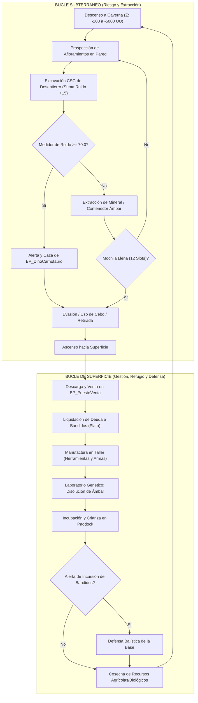
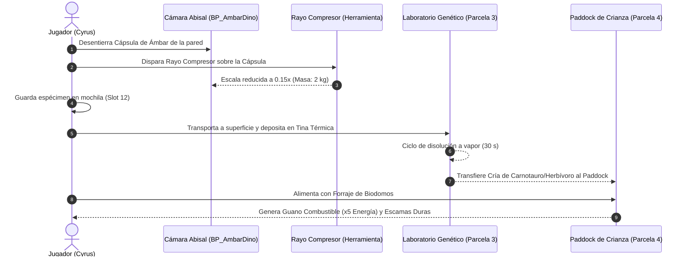

# GDD TÉCNICO MAESTRO: PROYECTO "ESTACIÓN NUEVE"
* **Documento para exportación y especificación:** Argon / Unreal Engine 5.8
* **Género:** FPP Survival / Mining Extraction / Base Management / Creature Breeding
* **Plataforma objetivo:** PC (Steam / Epic Games Store)
* **Arquitectura de motor:** Blueprints orientados a componentes + Subsystem Core (`USubsystem`)
* **Alcance de Entrega Semestral (Vertical Slice):** $30\text{ a }40\text{ minutos}$ de bucle jugable autosuficiente y pulido.
* **Alcance Comercial (Juego Completo):** $15\text{ a }20\text{ horas}$ de campaña con progresión tecnológica, asedios humanos y automatización de crianza.

---

## 1. IDENTIDAD DEL JUEGO Y CORE LOOP

### 1.1 Definición funcional
Juego de supervivencia y extracción en primera persona ambientado en una frontera industrial anómala posterior a 1890, donde el jugador (Cyrus) desciende a una gigantesca red de cavernas volumétricas destructibles para desenterrar minerales raros y cápsulas geológicas de ámbar con fauna prehistórica, evitando ser cazado por terópodos que rastrean vibraciones acústicas y defendiéndose de incursiones de bandidos en superficie. Los recursos financian el desarrollo modular de una base fija por parcelas (estilo *Slime Rancher*), la manufactura de armas balísticas y herramientas anómalas (como un compresor/encogedor de materia), y la operación de un laboratorio genético para incubar y domesticar dinosaurios útiles para el trabajo y la defensa.

### 1.2 Síntesis de referencias de ingeniería
* **Extracción destructible en tiempo real:** Basado en *Deep Rock Galactic* mediante Geometry Scripting y Dynamic Mesh Components (`DynamicMeshActor`), con sustracciones booleanas CSG en tiempo real sobre roca masiva.
* **Desentierro de recursos (Unearthing):** Los minerales no flotan en el aire; están sepultados dentro de la roca sólida, requiriendo abrir huecos volumétricos para descubrir su colisión y extraerlos (*Deep Rock Galactic* + *Minecraft*).
* **Construcción y expansión de base:** Basado en el sistema de parcelas y pedestales fijos de *Slime Rancher* y *Pacific Drive*, descartando la construcción libre pieza a pieza de *Subnautica* para garantizar rendimiento a 60+ FPS, navegación de IA sin fisuras y finalización en el plazo semestral.
* **Crianza y domesticación de criaturas:** Basado en *Slime Rancher* y *ARK: Survival Evolved*, transportando cápsulas de ámbar a un laboratorio en la base para incubar crías de dinosaurios en corrales (`Paddocks`) y cosechar subproductos biológicos de alto valor.
* **Tensión ambiental y sigilo acústico:** Basado en *A Quiet Place* y *Alien: Isolation*, con un medidor de ruido que orienta a la IA depredadora hacia el origen exacto de las vibraciones mecánicas.

### 1.3 Diagramas de flujo del Core Loop



---

## 2. LORE FUNCIONAL Y ECOSISTEMA DE FACCIONES

### 2.1 La Gran Catástrofe de 1890 (El Incidente Tectónico de Vapor)
* **Causa técnica del mundo:** Hacia finales del siglo XIX (circa 1890), una empresa minera pionera experimentaba con la inyección subterránea de vapor a ultra-alta presión para fracturar vetas profundas de carbón y petróleo. Un fallo en las válvulas de alivio coincidió con una detonación no controlada de toneladas de dinamita (TNT) en la galería matriz.
* **Efecto cinético global:** La explosión generó una onda de choque sísmica que fracturó las fallas basales del continente. Se sintió en estaciones sismológicas de todo el mundo y desgarró el cañón montañoso de Estación Nueve, despresurizando una red de cavernas donde emanaciones geotérmicas y mantos de ámbar puro preservaron fauna del Cretácico en estasis biológica.

### 2.2 Perfil del protagonista: Cyrus
* **Oficio:** Ingeniero mecánico y especialista en prospección de perforación.
* **Conflicto operativo (La Deuda):** Cyrus contrajo una fianza financiera exorbitante con un sindicato de prestamistas y bandidos de la frontera tras perder la maquinaria de su anterior expedición. Los acreedores lo trasladaron al cañón de Estación Nueve bajo amenaza de muerte: o entrega una cuota continua de mineral refinado y especímenes viables de ámbar en fechas límite estrictas, o la base será tomada por la fuerza.

### 2.3 Facciones humanas y de fauna
1. **El Sindicato de Bandidos ("Los Cobradores"):**
   * **Comportamiento:** PNJ humanos hostiles armados con armamento de pólvora y vapor rudimentario. 
   * **Lógica en el prototipo de 30 min:** No saturan la cueva (para no romper la atmósfera de terror minero); operan mediante **Incursiones Periódicas en Superficie** (cada 12 minutos de sesión, 2 o 3 bandidos intentan asaltar el muelle de suministros si la deuda no se ha pagado a tiempo).
2. **Fauna Nativa Subterránea (Carnotauro Ciego por Vibración):**
   * Depredador ápice que habita las profundidades ($Z < -1500\text{ UU}$). Carece de visión cromática; su árbol de comportamiento (`Behavior Tree`) se activa exclusivamente cuando el `UNoiseManagerSubsystem` supera el umbral acústico ($70.0\text{ dB/u}$).

---

## 3. ARQUITECTURA DE LA BASE: ESTUDIO COMPARATIVO Y SISTEMA DE PARCELAS

### 3.1 Análisis de ingeniería: ¿Construcción Libre (*Subnautica*) vs Parcelas Fijas (*Slime Rancher*)?

| Parámetro de Evaluación | Modelo Libre (*Subnautica*) | Modelo de Parcelas / Sockets (*Slime Rancher*) | Decisión Técnica para Estación Nueve |
|---|---|---|---|
| **Rendimiento y Draw Calls (UE 5.8)** | Alto costo por mallas modulares dinámicas solapadas y físicas complejas. | **Óptimo.** Actores instanciados con posiciones predecibles y colisiones fijas. | **Seleccionado: Parcelas Fijas.** Permite sostener 60+ FPS estables con MegaLights. |
| **Navegación de IA (NavMesh)** | Requiere NavMesh dinámico en tiempo real (`Runtime Generation: Dynamic`). Propenso a que la IA quede trabada en esquinas. | **100% Estable.** NavMesh precalculado estático; los módulos solo activan zonas de bloqueo definidas. | **Seleccionado: Parcelas Fijas.** Evita fallos críticos de navegación de dinosaurios y bandidos en la entrega semestral. |
| **Tiempo de Producción (Scope Semestral)** | 8 a 12 semanas solo para programar snapping, rotación, validación y soporte de guardado. | **2 semanas.** Sistema de interacción `BP_ParcelaBase` con estados visuales por Tiers. | **Seleccionado: Parcelas Fijas.** Garantiza que el juego se pueda jugar y terminar sin bugs este semestre. |

### 3.2 El Sistema de Parcelas de Estación Nueve (Socket Hub System)
El valle de la superficie cuenta con una infraestructura base preexistente pero destrozada. El jugador desbloquea y mejora **Parcelas Específicas (`BP_ParcelaBase`)** acercándose al pedestal e insertando la cantidad de recursos solicitada:

```text
                                  [TERRAZA ALTA HQ (Z = 0)]
                                             │
                        ┌────────────────────┴────────────────────┐
                        │   HQ Central y Consola de la Deuda      │
                        └────────────────────┬────────────────────┘
                                             │
                       RAMPA PRINCIPAL (Inclinación 18.43°, Ancho 800 cm)
                                             │
                                             v
  ┌────────────────────────────────────────────────────────────────────────────────────────┐
  │                           VALLE PRINCIPAL DE SUPERFICIE (Z = -200)                     │
  │                                                                                        │
  │  [PARCELA 1: NORTE]        [PLAZA CENTRAL]               [PARCELA 3: NORESTE]          │
  │  Pabellón de Comercio      Glorieta con Faro             Laboratorio Genético          │
  │  (Venta / Refinería)       (Punto de Spawn)              (Disolución Ámbar/Incubadora) │
  │                                                                                        │
  │  [PARCELA 2: SUR]          [CHOKEPOINT: BOCAMINA]        [PARCELA 4: SUROESTE]         │
  │  Planta de Vapor           Castillete y Tolva            Corral Paddock de Dinos       │
  │  (Generador Eléctrico)     (Acceso a la Cueva)           (Crianza y Subproductos)      │
  │                                                                                        │
  │  [PARCELA 5: NOROESTE]                                                                 │
  │  Biodomos Agrícolas (Cultivo de Forraje para Alimentación de Dinos y Cebos)            │
  └────────────────────────────────────────────────────────────────────────────────────────┘
```

#### Catálogo de Módulos de Base y sus Beneficios:
1. **Parcela 1 - Puesto de Comercio y Liquidación:**
   * *Función:* Venta de minerales y pago de las cuotas del pagaré de los bandidos para retrasar o anular sus incursiones armadas.
2. **Parcela 2 - Generador de Vapor y Red Eléctrica (`MegaLights`):**
   * *Nivel 1 ($150\text{ Plata} + 12\text{ Hierro} + 10\text{ Carbón}$):* Enciende faroles de base y alimenta el banco de trabajo del taller.
   * *Nivel 2 ($250\text{ Plata} + 20\text{ Hierro} + 15\text{ Carbón}$):* Activa los reflectores de alta potencia sobre la rampa de la mina; el Carnotauro es incapaz de invadir la superficie si los reflectores están activos.
3. **Parcela 3 - Laboratorio de Biología y Criocámaras:**
   * *Nivel 1 ($180\text{ Plata} + 14\text{ Hierro} + 8\text{ Resina}$):* Contiene la **Tina de Disolución Térmica**. Se coloca un bloque de `BP_AmbarDino`; tras $30\text{ segundos}$ de calor a vapor, el ámbar se disuelve y libera un embrión/cría viva.
   * *Nivel 2 ($300\text{ Plata} + 25\text{ Hierro}$):* Aumenta la velocidad de incubación a $10\text{ segundos}$ y añade cámara de síntesis de feromonas.
4. **Parcela 4 - Corral de Contención y Crianza (`Paddock`):**
   * *Función:* Aloja a las criaturas extraídas del laboratorio. Alimentándolas con `Forraje`, los dinosaurios crecen y generan **Guano Hipercombustible** (sustituto del carbón que quintuplica la velocidad del generador) y **Escamas Duras** (insumo para fabricar blindaje corporal).
5. **Parcela 5 - Biodomos Agrícolas:**
   * *Función:* Cultivo automatizado de forraje prehistórico cada $12\text{ segundos}$.

---

## 4. DIMENSIONES DEL MAPA Y LEVEL DESIGN

### 4.1 Métricas espaciales cuantitativas
* **Valle de Superficie:** $110\text{ m} \times 130\text{ m}$ ($11{,}000 \times 13{,}000\text{ UU}$). Área: $14{,}300\text{ m}^2$.
* **Macizo Subterráneo Masivo (`EN_Terreno`):**
  * Dimensión en X: $250\text{ m}$ ($25{,}000\text{ UU}$, desde $X = 0$ hasta $X = 25000$).
  * Dimensión en Y: $180\text{ m}$ ($18{,}000\text{ UU}$, desde $Y = -9000$ hasta $Y = +9000$).
  * Dimensión en Z (Profundidad vertical): $50\text{ m}$ ($5{,}000\text{ UU}$, desde $Z = -200$ hasta $Z = -5200$).
  * Volumen rocoso total: $2{,}250{,}000\text{ m}^3$ ($2.25\text{ millones de m}^3$).

### 4.2 Zonificación y ramales subterráneos
```text
[Z = -200 a -600 UU]     BOCAMINA Y RAMPA DE ENTRADA (Ancho libre 650 cm, Pendiente 33.5°)
                          │
[NIVEL 1: Z = -600 a -1500] ESTRATO SUPERIOR: ARENISCA Y MADERA
                          - Túneles reforzados con vigas de soporte minero.
                          - Yacimientos sepultados de Hierro y Carbón superficial.
                          │
                          ├─► RAMAL NORTE ("El Nido de Caza", Z = -1800)
                          │   - Túneles estrechos (diámetro 280-350 cm). Patrulla de IA.
                          │
                          ├─► RAMAL SUR ("Falla Ciega de Prospección", Z = -2200)
                          │   - Roca sólida masiva sin túnel previo; exige minar a ciegas.
                          │   - Grandes concentraciones de resina fósil y bolsas de mineral ocultas.
                          │
                          └─► SIMA CENTRAL VERTICAL (Z = -1500 a -3500)
                              - Gran pozo de 20 m de diámetro con repisas rocosas.
                              │
[NIVEL 2: Z = -3500 a -5000] BÓVEDA ABISAL ANCESTRAL
                              - Cúpula de 45 m de diámetro y 22 m de altura.
                              - 5 Cristales gigantes de resonancia geotérmica.
                              - 4 Nichos con cápsulas monolíticas de ámbar (BP_AmbarDino).
```

### 4.3 Sistema de Minerales Sepultados (Mecánica de Desentierro / Unearthing)
* **Regla estricta:** Queda terminantemente prohibido situar actores `BP_Veta` flotando o apoyados en el suelo libre de los túneles.
* **Profundidad de enterramiento:** Los actores `BP_Veta` se sitúan entre $100\text{ cm}$ y $300\text{ cm}$ en el interior de la malla sólida de `BP_TerrenoExcavable`.
* **Afloramiento visual (Seam Cue):** Se deja visible únicamente un $10\%$ a $15\%$ de la silueta en la cara expuesta de la roca, acompañado de un destello reflectivo de material o partículas microscópicas.
* **Proceso de extracción:**
  1. El jugador pica la roca adyacente (`LMB`).
  2. La sustracción booleana CSG remueve la capa de piedra envolvente.
  3. Al descubrirse el volumen, el actor `BP_Veta` conmuta su colisión a `BlockAllDynamic`.
  4. El jugador impacta directamente la veta expuesta para recolectar el mineral y añadirlo al inventario.

---

## 5. CHARACTER CONTROLLER, ARSENAL Y HERRAMIENTAS ANÓMALAS

### 5.1 Jerarquía de componentes de Cyrus (`BP_Cyrus`)
* `UCapsuleComponent` ($H = 96.0\text{ cm}, R = 42.0\text{ cm}$).
* `UCameraComponent` ($Z = 74.0\text{ cm}$).
* `UCharacterMovementComponent` (`WalkSpeed = 450 cm/s`, `SprintSpeed = 750 cm/s`, `CrouchSpeed = 200 cm/s`).
* `UInventoryComponent`: $12\text{ slots}$ base (ampliable a $24\text{ slots}$ con exoesqueleto).
* `UNoiseEmitterComponent`: Reporta las vibraciones acústicas de pisadas y herramientas al `UNoiseManagerSubsystem`.

### 5.2 Arsenal balístico convencional (Defensa contra Bandidos y Aturdimiento)
Los dinosaurios de la cueva no mueren con balas normales (su piel fósil/densa requiere trampas o armas pesadas), pero las armas de fuego son indispensables para defender la base de las incursiones de bandidos:

| Arma / Ítem | Tipo de daño / Disparo | Cadencia / Capacidad | Efecto táctico |
|---|---|---|---|
| **Revólver Frontier .44** | Balístico perforante ($45\text{ DMG}$) | 6 disparos ($1.2\text{ s}$ recarga) | Elimina bandidos de 2 impactos al torso. Desvía la atención del Carnotauro hacia el punto de impacto de la bala. |
| **Escopeta de Palanca 1887** | Dispersión de perdigones ($90\text{ DMG}$) | 5 cartuchos ($0.8\text{ s}$ ciclo) | Neutralización letal a corta distancia contra asaltantes. Provoca un retroceso/aturdimiento de $1.5\text{ s}$ al Carnotauro si impacta en el rostro. |
| **Dinamita con Mecha** | Explosivo de área ($250\text{ DMG}$, radio $400\text{ cm}$) | Lanzamiento físico manual ($3.0\text{ s}$ mecha) | Vuela paredes de roca masiva sin túnel y erradica grupos de bandidos emboscados. Genera $+80.0$ de ruido de golpe. |

### 5.3 Herramientas anómalas (Retro-SciFi / Tecnología de Vapor Anómalo)

#### A. El Rayo Compresor / Encogedor de Materia (`BP_CompresorMateria`)
* **Concepto técnico:** Dispositivo experimental alimentado por vapor presurizado y resonancia de cristales que altera localmente la densidad atómica de los objetos físicos.
* **Función 1: Encogimiento de Carga Pesada:** 
  * Los contenedores de `BP_AmbarDino` pesan $250\text{ kg}$ y son imposibles de cargar a mano en la mochila.
  * Al disparar el rayo sobre la cápsula de ámbar, su escala interpola de $1.0$ a $0.15$ ($15\text{ cm}$ de tamaño) y su masa se reduce a $2\text{ kg}$.
  * El jugador puede meter el espécimen encogido en un slot de la mochila y transportarlo a superficie sin quedar inmovilizado.
* **Función 2: Compresión de Escombros y Bloques:**
  * Al picar roca, reduce el descarte de grava en esferas ultra-compactas, facilitando la limpieza de túneles estrechos.

#### B. Georadar Acústico de Prospección
* Pulso de sonar que revela la silueta tridimensional de las vetas ocultas hasta a $600\text{ cm}$ de profundidad detrás de las paredes rocosas durante $4.0\text{ segundos}$.

---

## 6. SISTEMAS DE INTERACCIÓN, LABORATORIO Y CRIANZA DE DINOSAURIOS



### 6.1 Lógica del Laboratorio Genético
1. **Recepción del espécimen:** Cyrus deposita la cápsula encogida en la tina del laboratorio interactuando con la tecla `E`.
2. **Proceso de extracción:** La tina inyecta vapor térmico a presión. Un temporizador de $30.0\text{ segundos}$ en pantalla disuelve el ámbar exterior.
3. **Liberación de la criatura:** Al completarse el tiempo, la cría del dinosaurio realiza spawn en el corral anexo (`BP_PaddockDino`).

### 6.2 Lógica del Paddock de Crianza
* **Alimentación:** Requiere $2\text{ unidades}$ de `Forraje` por ciclo ($60\text{ s}$).
* **Producción pasiva:**
  * **Guano de Terópodo:** Se utiliza directamente en el Generador de Vapor para proveer energía ininterrumpida durante 10 minutos sin consumir carbón.
  * **Feromona de Calma:** Se embotella y se arroja en la mina para neutralizar temporalmente la hostilidad del depredador adulto.
* **Bestia de Guardia:** Al alcanzar el estado juvenil, el dinosaurio del corral ataca automáticamente a los bandidos que intenten vulnerar las puertas de la base en superficie.

---

## 7. ROADMAP Y ALCANCE DE PRODUCCIÓN

### 7.1 Alcance del Prototipo Semestral (Vertical Slice - 30 a 40 minutos)
* **Objetivo de entrega:** Una experiencia jugable completa, cerrada, testeable y sin errores para evaluación académica.
* **Contenido exacto del prototipo de 30 min:**
  1. Base de Superficie con **3 Parcelas operativas:** Puesto de Venta, Taller de Mejoras (Pico Tier 1) y Laboratorio/Tina de Ámbar inicial.
  2. Red de Cavernas con **Nivel 1 (Superior) y acceso al Nivel 2 (Sima Central)**, con vetas de hierro, carbón y resina sepultadas.
  3. **1 Cápsula de Ámbar** que debe ser encontrada, encogida con el Rayo Compresor, transportada a la base e incubada.
  4. Presencia del **Carnotauro depredador por sonido** patrullando el nivel intermedio.
  5. **1 Incursión de Bandidos (2 enemigos)** en el minuto 15 de partida para probar el combate con armas de fuego en la base.
  6. **Condición de victoria del prototipo:** Pagar la primera cuota de la deuda (\$200 Plata) y colocar la primera cría de dinosaurio en el corral.

### 7.2 Alcance del Juego Comercial Completo (15 a 20 horas)
* **Profundidad total:** Descenso a los $50\text{ metros}$ reales de la Bóveda Abisal ($Z = -5000$).
* **Árbol tecnológico completo:** 5 Tiers de herramientas, 5 parcelas de base con 3 niveles cada una, 4 especies diferentes de dinosaurios para criar en laboratorios avanzados.
* **Facciones dinámicas:** Campamentos de bandidos en la superficie exterior del cañón que pueden ser asaltados o saboteados.
* **Final cinemático:** Pagar la deuda total, repeler el asalto final del líder de los bandidos con ayuda de tus dinosaurios criados y abordar el tren blindado de evacuación sellando el cañón para siempre.

---

```text
================================================================================================
                                FIN DEL GDD TÉCNICO MAESTRO
         (Formateado y listo para importación en sistemas de gestión documental / Argon)
================================================================================================
```